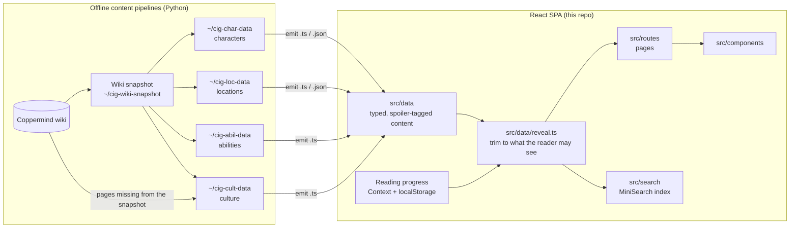

# Architecture

How the Cosmere Interactive Guide is built, and why. Each decision lists the
trade-off it makes and the point at which it should be revisited.

## 1. What the system has to do

The product is a spoiler-safe reference to Brandon Sanderson's Cosmere. That
drives almost every architectural choice:

| Requirement                                                           | Consequence                                                                                                                                  |
| --------------------------------------------------------------------- | -------------------------------------------------------------------------------------------------------------------------------------------- |
| **Never show a reader something from a chapter they haven't reached** | Every fact carries its own reveal date; filtering happens once, centrally, before rendering. Correctness here matters more than any feature. |
| Content is read-mostly and changes in batches                         | Content is built offline and shipped with the app; no runtime writes.                                                                        |
| Private, single maintainer, zero ops budget                           | Static single-page app, no backend, no accounts.                                                                                             |
| Reading progress is personal                                          | It lives in the reader's browser.                                                                                                            |
| Thousands of characters and places over time                          | Large text is split into chunks loaded on demand; the core index stays small enough to search on the client.                                 |

## 2. System overview



Runtime is a static bundle (Vite build output) that any static host can
serve. There's no server, API or database.

## 3. Stack

| Concern     | Choice                                                                                   | Why                                                                                                                                                                                                                                          |
| ----------- | ---------------------------------------------------------------------------------------- | -------------------------------------------------------------------------------------------------------------------------------------------------------------------------------------------------------------------------------------------- |
| UI          | **React 19** with `StrictMode`                                                           | Industry standard, large ecosystem; StrictMode surfaces unsafe effects early.                                                                                                                                                                |
| Language    | **TypeScript 6**, strict-ish (`noUnused*`, `verbatimModuleSyntax`, `erasableSyntaxOnly`) | The content model is the product; types make a malformed fact a compile error, not a leaked spoiler. `erasableSyntaxOnly` keeps TS as pure type annotations (no enums or namespaces), so code runs unchanged under any TS-stripping runtime. |
| Build/dev   | **Vite 8**                                                                               | Fast HMR, native ESM, first-class code splitting via `import.meta.glob`. The current default for client-side React (Create React App is deprecated).                                                                                         |
| Routing     | **React Router 8**, data router (`createBrowserRouter` + route objects)                  | Route config is plain data (`src/routes.tsx`), shared by the app and the tests, with an `errorElement` boundary at the root.                                                                                                                 |
| Search      | **MiniSearch**                                                                           | Small, client-side, fuzzy and prefix matching; no service to run.                                                                                                                                                                            |
| Motion      | **motion** (`AnimatePresence`, `MotionConfig reducedMotion="user"`)                      | Page transitions that respect the OS "reduce motion" setting by default.                                                                                                                                                                     |
| Tests       | **Vitest 5 + Testing Library + jsdom**                                                   | Shares Vite's config and transforms; Testing Library pushes tests toward user-visible behaviour.                                                                                                                                             |
| Lint/format | **oxlint**, **Prettier**                                                                 | oxlint is fast enough to run on every change; Prettier ends style debates.                                                                                                                                                                   |

The runtime dependencies are deliberately few: React, React Router,
MiniSearch, motion and one font. Each one is a long-term maintenance cost,
so state management, data fetching and UI kits are handled with the
platform and React itself (see 5.4).

## 4. Source layout

```
src/
  main.tsx            Entry: router + global CSS
  routes.tsx          Route table (data, not JSX trees)
  navigation.ts       Header tabs; tabs marked comingSoon get placeholder routes automatically
  routes/             One component per page (lists, detail pages, search, errors)
  components/         Reusable UI: layout shell, maps, charts, sections/Contents, search box
    journey/          Journey map: engine interface, SVG engine, preview, full map (5.9)
  data/               Content + domain logic
    types.ts          The content model (Reveal, Character, Location, ...)
    reveal.ts         Spoiler engine: pure functions that trim data to the reader
    progress.ts       Book/chapter ordering and "has the reader reached X?"
    *.ts              Generated or hand-written content modules
    stories/*.json    Per-character long text, one lazily loaded chunk each
    journeys/*.json   Journey packs (5.9), loaded lazily
  state/              Reader progress (Context, persistence) and reveal hooks
  search/             Index construction, sources, hooks
  styles/app.css      Loads index.css into the `base` cascade layer
  styles/index.css    Global stylesheet with design tokens
  test/setup.ts       jest-dom matchers
scripts/              Node tooling (Coppermind fetch, spoiler time-machine check)
```

**Why organise like this:** the folders follow the dependency direction, with
`data` at the bottom, then `state`, `search`, `components` and `routes` at
the top. Nothing in `data/` imports React, so the domain logic (including
the whole spoiler engine) is plain TypeScript that can be unit-tested
without rendering and reused by Node scripts (`scripts/spoiler-snapshot.ts`
imports it directly).

## 5. Key decisions

### 5.1 Spoiler safety is a data-layer concern, not a UI concern

Every piece of content has `revealedIn: Reveal`, an _any-of_ list of points:

```ts
type RevealPoint =
  | string /* finished book */
  | { book: string; chapter: string } /* reached chapter */
  | { all: RevealPoint[] } /* needs every part, e.g. two series */
type Reveal = readonly RevealPoint[]
```

`readerCanSee(progress)` turns the reader's progress into a predicate, and
`reveal*` functions (`revealCharacter`, `revealStory`, `revealSystem`,
`revealLocationDetails`, ...) return **new, trimmed objects** with hidden
facts removed. Components only ever receive the trimmed result.

Why:

- **One choke point.** Hiding things in JSX (`{canSee(x) && ...}`) scattered
  across components is how leaks happen. Here a component _cannot_ render a
  hidden fact because it never receives it. This is the same principle as
  authorising at the data boundary rather than in the view.
- **Fail closed.** Unknown chapter ids, missing dates or unmet characters
  are treated as hidden, so a bug in the app's logic tends to hide content
  rather than leak it. A wrongly dated fact in the data still leaks; that
  risk is handled by the pipeline's dating rules and spoiler reviews, not
  by this model.
- **No hints.** Hidden things are removed completely: no placeholders,
  counts by book, or empty headings. The only exception is one generic
  "Some information hidden due to spoilers" notice that never names a book.
- **Pure functions** are trivially testable at exact reading positions
  (e.g. "at The Way of Kings chapter 56 this ability is absent, at 57
  present"), which is what the test suite does.
- Search, lists, group-by headings and the Contents panel all draw from the
  same trimmed data, so secondary surfaces can't leak either. The lists'
  page feature icons (`data/pageFeatures.ts`: a registry whose finders
  return the section id a page shows, built from the same `reveal*` and map
  helpers as the page) work the same way, by books alone. (The Contents
  panel reads headings from the rendered DOM, so it can only list what was
  rendered.)

This is chosen as the simplest model that is correct and fast enough at
this scale, not a proven optimum. Trade-offs:

- **Spoilers ship in the bundle.** It prevents accidental spoilers, not a
  reader inspecting the JavaScript. Withholding data for real needs
  per-book data chunks or a server.
- **Linear recomputation.** Each progress change re-filters every fact
  (a few thousand, cheap, memoised on progress). A precomputed index or
  bitmask per fact would be faster but isn't needed yet.
- **Authoring cost.** Points are written per fact, with some repetition;
  prose must be split into separately dated passages; personas need extra
  logic on top of the predicate.

**Revisit** if the data grows by around 100×, if spoilers must be truly
withheld, or if a fact turns up that an any-of list of points can't date.

### 5.2 Content is compiled into the app, produced by offline pipelines

The content comes from the Coppermind wiki. Python pipelines (outside this
repo) snapshot the wiki, parse it, date each fact by its footnotes, run
consistency and spoiler checks, and **emit** TypeScript/JSON into
`src/data`. Generated files are never hand-edited; corrections go into
pipeline override files and are re-emitted.

Why:

- **Build-time validation.** Content is type-checked like code, and data
  tests (unique ids, valid book ids, references that resolve, reveal dates
  consistent with sources) run in CI-style checks before anything ships.
- **Reproducible and reviewable.** A wiki snapshot plus a deterministic
  pipeline means a content change is a reviewable diff, and a past state
  can be rebuilt. Reading the wiki live at runtime would make spoiler
  safety depend on someone else's edits.
- **Zero infrastructure.** No database, API, auth or uptime to manage for a
  read-only, private project.
- **Licensing hygiene.** Text is paraphrased and attributed once, in the
  pipeline, rather than proxied live.

Trade-off: every content change needs a rebuild and deploy, and the
pipelines live outside version control today (a risk; see section 8).
**Revisit** if non-engineers need to edit content, or if content outgrows
the bundle. The stretch-goal path in `ROADMAP.md` (move content to a
database behind a read-only API, keeping the same `Reveal` model and doing
the trimming server-side) is a migration, not a rewrite, because the
model and the trimming functions are already isolated.

### 5.3 Code splitting for long text; small indexes stay eager

Long prose (character and place histories) is one JSON file per entity,
loaded with `import.meta.glob(..., { import: 'default' })`. Vite turns each
into its own chunk, fetched when its page opens and cached in a `Map`.
Lists, key facts, search names and reveal dates stay in the main bundle,
because the list, group-by, search and "has the reader met them?" checks
need them synchronously.

Why: this is the standard "split by route/entity, keep the shell
synchronous" approach. It keeps the first paint free of loading spinners
for navigation and search, while ~1.5 MB of prose (and growing) stays out
of the initial download.

Trade-off: the main chunk is ~1.17 MB (~308 kB gzipped) and Vite warns
about it. **Revisit** as more series land: split the details module per
series, or move the eager indexes to a fetched JSON file with a small
loading state.

### 5.4 State: React Context + localStorage + the URL; no state library

| State                                                                | Where it lives                                                                     | Why                                                                                                                                                                                                                           |
| -------------------------------------------------------------------- | ---------------------------------------------------------------------------------- | ----------------------------------------------------------------------------------------------------------------------------------------------------------------------------------------------------------------------------- |
| Reading progress (books finished, current chapter)                   | `BooksReadProvider` Context, persisted to `localStorage` under a **versioned** key | Global, rarely changes, needed everywhere. Context is enough. Versioning (`{version: 2, ...}`) lets the format evolve; the loader validates and migrates v1, and treats corrupt data as "not chosen yet" instead of crashing. |
| "Show anyway" opt-ins                                                | Same Context, memory only                                                          | A deliberate, per-visit choice; persisting it would surprise a reader later.                                                                                                                                                  |
| Filters, group-by, layout trials (`?q=`, `?group=`, `?layout=`)      | URL search params via `useSearchParams`                                            | Shareable, bookmarkable, back-button friendly, and survives reloads. URL as state is the recommended pattern for view state.                                                                                                  |
| Section anchors (`#history-bridgeman`)                               | URL hash                                                                           | Deep links into a page; old tab URLs redirect to hashes so links keep working.                                                                                                                                                |
| Derived data (trimmed systems, the `canSee` predicate, search index) | `useMemo` in hooks (`useShownSystems`, `useCanSee`, `useSearch`)                   | Derived, not stored, so there's no duplication to keep in sync.                                                                                                                                                               |
| Local UI (collapsed sections, open menus)                            | `useState` in the component                                                        | Co-located with the only consumer.                                                                                                                                                                                            |

Why no Redux, Zustand or React Query: there's one piece of truly global
state and no server data. Adding a store would add indirection without
solving a problem. The provider's value is memoised and its callbacks are
derived from that memoised value, so consumers re-render only when progress
actually changes.

### 5.5 Routing: route table as data, layout route, error boundary

`src/routes.tsx` exports a `RouteObject[]` used by both `main.tsx`
(`createBrowserRouter`) and the tests (`createMemoryRouter`). A single
layout route renders the header (tabs, search, Books Read) and an animated
outlet; an `errorElement` catches render and loader errors; `*` gives a 404. Header tabs are declared once in `navigation.ts`; a tab flagged
`comingSoon` gets a placeholder route automatically, so the nav can never
point at a missing page.

Why: one source of truth for URLs, tests that exercise real routing rather
than mocks, and a predictable place to add code splitting (`lazy`) per
route when the bundle needs it.

### 5.6 Search built per reader, lazily

`useSearch()` builds a MiniSearch index over **only the entries the reader
may see**, on first use, and rebuilds when progress changes. Accent- and
apostrophe-insensitive tokenising, prefix and light fuzzy matching.

Why: searching an index of everything and filtering the results would still
leak through suggestions, fuzzy matches or result counts. Building the
index from trimmed data closes that hole by construction. Lazy construction
keeps pages that never search from paying for it.

### 5.7 Components: semantic HTML first, accessibility built in

- Landmarks and roles (`article`, `nav`, `aside` "Key facts", `section`
  regions with `aria-labelledby`), real `<button>`s and links,
  `aria-expanded`/`aria-controls` on collapsible sections,
  `aria-current="location"` in the Contents panel, `aria-pressed` toggles.
- The native `<dialog>` element for the Books Read modal (focus trapping
  and Esc for free).
- Motion respects `prefers-reduced-motion`.
- Tests query by role and accessible name, so accessibility regressions
  break tests.

Why: semantic markup is the cheapest accessibility, and Testing Library's
role queries make it enforceable.

Reusable page structure is shared through small, composable components
(`PageSection`, `PageSubsection`, `PageContents`, `SpoilerNotice`, map and
chart components) rather than inheritance or configuration objects.
Communication between distant components uses DOM events where that's
simpler (the Contents panel asks a collapsed section to open with a custom
event) instead of lifting state through unrelated parents.

### 5.8 Styling: global tokens in a layer, CSS Modules per component

`src/styles/index.css` holds CSS custom properties (colours, fonts), page
layout and the older class names (`.character-detail`, `.page-contents`,
...). `src/styles/app.css` imports it into `@layer base`. Components are
moving to their own CSS Modules beside them (`EntryCards.module.css`),
which Vite scopes by hashing class names. Layout uses CSS Grid with named
areas and media-query breakpoints (wide: text, infobox, Contents; medium:
Contents under the infobox; phone: one column).

Why: no runtime CSS-in-JS cost, no build plugin, one visual language. A
single ~5,000-line global file relied on naming discipline, and a page rule
(`.character-story .page-subsection`) once silently overrode the entry
cards' grid. Modules can't leak into other components, and because module
CSS is unlayered it always beats `base`, whatever the specificity, so a
component never fights a global rule. Responsive layout is handled by CSS,
not by JavaScript reading the window size.

Rules for new or migrated components:

- One `<Component>.module.css` beside the `.tsx`; camelCase class names.
- Only tokens (`var(--gold)`), the reset and page layout stay global.
- A parent changes a child through a prop or `className`, not a
  descendant selector into it.
- Tests find elements by role, text or label, never by a module class.
- Reach a global class from a module with `:global(.name)` only when the
  component renders it (e.g. the shared `.art-open` button).

Trade-off: migration is incremental, so for a while both styles coexist;
tests that selected by class name need rewriting as each component moves.

### 5.9 Journey maps: one generic model, importers outside, a swappable engine

A journey is where characters go, as events on maps, each gated by its own
chapter. The code knows nothing about the Cosmere, so the app can become a
template for other series.

- **Model** (`src/data/journey.ts`, documented in place):
  - `JourneyEvent { id, characters, mapId, path: [x, y][], placeId?,
placeRevealedIn?, revealedIn, order, approximate?, title?, summary?, art?,
source? }`. `summary` is parts `{ text, revealedIn, supersededIn?, cite?,
links? }`, each shown at its own chapter until a fuller part takes over;
    `links` make names character links once met; `cite` names an
    out-of-book source (a Word of Brandon), shown as a `SourceMark` (a small
    book badge: hover, focus or tap for the sources and their links). The
    same mark gives the book sources of History paragraphs and Travels
    events (`{bookId, chapter?}`, shown as "<book> chapter 16" like the
    Coppermind's footnotes), and the sources of a character's `born` and
    `age` Key facts; `born`'s date and place each get their own mark (the
    place's is the chapter of the first version to give it).
    Both are versions in story order; the page shows the latest revealed
    (`born` gains a `placeId` once the birthplace is known; `age` is shown
    "in <book>"). Until `placeRevealedIn` the event has no point on
    the map and no place (the map shows whole), e.g. a birth year known
    before the birthplace.
    `art` is `{ src, alt, credit, position? }`, a WebP in
    `public/journey-art/` named by the event's neutral id. `path` is in the
    map image's pixels; one point is a stay, several a route. `order` is
    the in-world timeline (so flashbacks fall into place), else reading
    order. Ids are neutral hashes, as source ids can name what happens.
  - `JourneyPack { id, credits, events }`: one JSON file per pack
    (`src/data/journeys/<pack>.json`), loaded lazily
    (`journeyPacks.ts`, `useJourneyPacks`). The small, eager
    `journeyIndex.ts` lists each character's packs, maps and reveal points,
    so lists and page features know synchronously whether a reader sees
    any journey.
  - `Atlas { map(id), place(id) }`, supplied by the series
    (`journeyAtlas.ts` adapts `maps.ts` and the Locations list). An
    `AtlasMap` can have a `parent` (map id, place, point): the star map is
    just a top map with planet maps as children, as Middle-earth would be
    with regional maps. A world hop is an event on the top map with the
    planet as its place; drill-down follows `parent` links. City maps
    (Luthadel, Fadrex City) are wired this way: `revealJourney` adds a
    stop's visible parent chain to `maps`; on the parent, inner stops are
    drawn at the city's pin (`pathsOn`, `anchorOn`, `rootOf` in
    `journeyGeometry.ts`). `JourneyMap` zooms into the pin and swaps to the
    city map, or zooms out over the pin and then pans, drawing a new leg
    only after the swap. The star map isn't wired yet.
- **Trimming** (`reveal.ts`): `revealJourney` keeps the events the reader
  has reached, in `order`, names and links a listed place only once it's
  revealed, else names the event's own `placeName` (safe at its chapter;
  every event has one, so every stop says where it is), keeps a
  hand-written summary's passages by their own points, and reports whether
  anything was hidden (`spoilers`) for the Show anyway notice.
  `revealCharacterJourney` and `journeyShown` serve pages and page
  features. Unknown chapter ids stay hidden mid-book.
- **Engine** (`components/journey/MapEngine.ts`): `flyTo(box, {animate,
maxZoom, inset})`, where `inset` is the screen pixels panels cover, so
  the box is centred in the clear part, plus `layers(zoom)` drawn in image pixels. `SvgMapEngine` is
  an SVG overlay on the image inside `PanZoom`, whose imperative
  `flyTo`/`reset` (fit maths in `fitTransform.ts`) animate a CSS
  transform. A WebGL engine (e.g. PixiJS) could replace it behind the same
  interface if an all-characters map needs thousands of paths.
- **UI**: `JourneyPreview` (blurred whole map with an Explore button,
  eager) lazy-loads `JourneyMap` (event card popup with art and a
  lightbox, overlay timeline, playback, full screen via
  `useFullscreen`: the Fullscreen API where it works, else a fixed overlay).
- **Importers** live in `~/cig-journey-data` (Python): one per source, each
  fitting the source's coordinates onto one of our maps (affine least
  squares over matched places, residuals stored), mapping chapter refs to
  our chapter ids (unknown: dropped) and emitting packs and the index.
  Sources give numbers only, never prose. Event text is ours
  (`text/*.json`); event art is fan art, chosen per event, credited, and
  cleared with the artist before any public release.

Why: a fan map's data is the cheapest source of positions, but each source
has its own map, ids and chapter notation. Normalising at the pipeline
boundary keeps the app to one schema and one trimming function, the same
approach as the other content (5.1, 5.2).

Trade-off: positions inherit the source's accuracy plus the fit's error
(RMS ~4 px on our 2560 px Roshar map). **Revisit** the engine if a map
needs many thousands of paths.

## 6. Quality gates

Run before every change:

```sh
npx tsc -b && npm run lint && npx vitest run && npm run build
```

- **Type check** across three projects (`app`, `node`, `scripts`) via
  project references.
- **Tests (~290)**, in three layers:
  - _Data integrity:_ unique ids, known book ids, references that resolve,
    dates consistent with sources (`src/data/*.test.ts`).
  - _Spoiler behaviour:_ render real routes at exact reading positions and
    assert what is and isn't visible (`src/characters.test.tsx`,
    `src/spoilers.test.tsx`, `src/locations.test.tsx`). Every new kind of
    reveal gets a test.
  - _Component behaviour:_ search, maps, pan and zoom, sections and the
    Contents panel.
- **Content checks** outside the test suite: the pipeline's dating checks,
  independent spoiler reviews, and `npm run spoiler:snapshot`, which
  compares what a character page shows at each point with the wiki as it
  was at that time (Wayback Machine snapshots).
- **Visual checks:** headless-Chrome screenshots at desktop and phone sizes
  with a seeded reading position (`scripts/screenshot-seed.html`).

## 7. Performance notes

- Static assets only; cacheable on any CDN.
- Per-entity text chunks (5.3), lazy search index (5.6), memoised derived
  data (5.4).
- Scroll tracking for the Contents panel does a handful of layout reads per
  scroll event on one scroller and is detached on unmount.
- Known cost: the eager main chunk (5.3).

## 8. Known gaps and next steps

| Gap                                                           | Risk                                                      | Suggested fix                                                               |
| ------------------------------------------------------------- | --------------------------------------------------------- | --------------------------------------------------------------------------- |
| Content pipelines (`~/cig-*-data`) are not in version control | Loss of the dating logic and overrides; no review history | Move them into this repo (e.g. `pipeline/`) or their own repo.              |
| No CI                                                         | Gates rely on discipline                                  | A GitHub Actions workflow running the four checks on every push and PR.     |
| Main chunk ~1.17 MB                                           | Slower first load on mobile                               | Split content per series or fetch the indexes; add `lazy` routes.           |
| Single global stylesheet                                      | Naming collisions as pages multiply                       | Migrate to CSS Modules incrementally.                                       |
| Content updates need a deploy                                 | Fine for one maintainer                                   | Stretch goal: a read-only API with server-side trimming (see `ROADMAP.md`). |

## 9. Principles to keep

1. **Trim, then render.** New content types get a `reveal*` function and a
   reading-position test before they get UI.
2. **Fail closed.** If a date is unknown, hide it.
3. **Generated means generated.** Fix the pipeline input, not the output.
4. **Derive, don't store.** Anything computable from progress plus content
   is a memoised hook, not state.
5. **Add a dependency only when the platform or React can't do the job.**
